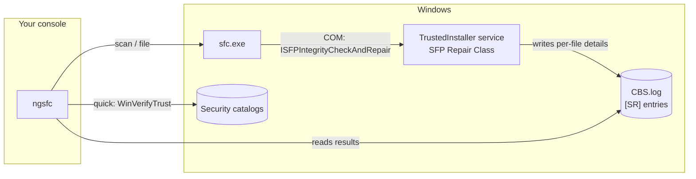

<div align="center">

# ngsfc

### Next Gen System File Checker

**`sfc /scannow` tells you something is wrong. ngsfc tells you what, why, and whether it got fixed.**

[](https://github.com/MAXIVA11/NextGenSFC/releases/latest)
[](https://github.com/MAXIVA11/NextGenSFC/releases)


[Download](https://github.com/MAXIVA11/NextGenSFC/releases/latest) ·
[Quick start](#quick-start) ·
[Commands](#commands) ·
[Scripting](#scripting) ·
[How it works](#how-it-works) ·
[The sfc.exe teardown](docs/SFC-ANALYSIS.md)

</div>

---

## The problem with `sfc`

You run `sfc /scannow`, wait, and get this:

```
Windows Resource Protection found corrupt files but was unable to fix some of them.
For online repairs, details are included in the CBS log file ...
```

Which files? Why? `CBS.log` is a multi-megabyte servicing log shared with Windows
Update. And if you were hoping to check `%ERRORLEVEL%` from a script: `sfc` exits
`0` whether the system is clean or corrupt.

ngsfc started as a reverse-engineering exercise on `sfc.exe` itself
([full write-up](docs/SFC-ANALYSIS.md)). The finding that shaped it: `sfc.exe`
contains no verification code at all. It is a thin console client for the
TrustedInstaller service, and the per-file details it withholds from you are
sitting in the log the whole time.

## What you get instead

| | `sfc.exe` | `ngsfc` |
| --- | --- | --- |
| Which files were corrupt | "see CBS.log" | Listed, with reason and repair state |
| Exit code | `0` for clean *and* corrupt | One code per outcome |
| Machine-readable output | No | `--json` on every command |
| Works on non-English Windows in scripts | Parse localized text yourself | Outcome is language-independent |
| Component store is damaged | Tells you to go run DISM | `--escalate` runs DISM and rescans |
| Review the last scan later | Re-run the scan | `ngsfc report`, instant |
| Without administrator rights | Nothing works | `report`, `status`, `quick` all work |
| Second opinion | None | `quick`: signature sweep, ~7,700 files in ~8 s |

The scan and repair engine is unchanged: ngsfc drives the same Windows Resource
Protection service `sfc` does. It does not replace Microsoft's repair logic; it
replaces the part that talks to you.

## Quick start

1. Download `ngsfc-<version>-windows-amd64.exe` from the
   [latest release](https://github.com/MAXIVA11/NextGenSFC/releases/latest) and
   rename it to `ngsfc.exe`. It is a single file with no installer and no
   dependencies.
2. Try the commands that need no elevation:

   ```
   ngsfc status
   ngsfc quick
   ```

3. For a real scan, open an **elevated** terminal (Run as administrator):

   ```
   ngsfc scan
   ngsfc scan --repair
   ```

> [!NOTE]
> The release binary is not code-signed, so SmartScreen may warn on first run.
> Each release lists the SHA-256 of the binary; or build it yourself in one
> command (see [Building](#building)).

## Commands

| Command | Admin | Purpose |
| --- | :---: | --- |
| [`ngsfc scan`](#scan) | yes | Verify every protected system file; optionally repair |
| [`ngsfc file <path>`](#file) | yes | Verify or repair a single file |
| [`ngsfc report`](#report) | no | Show what the last scan flagged |
| [`ngsfc quick`](#quick) | no | Fast signature sweep of system binaries |
| [`ngsfc status`](#status) | no | Is this machine ready for a scan? |
| `ngsfc version` | no | Print the version |

Every command accepts `--json`.

### `scan`

```
ngsfc scan                       verify only; changes nothing
ngsfc scan --repair              verify and repair
ngsfc scan --repair --escalate   if repair fails, run DISM /RestoreHealth, then scan again
```

Illustrative output for a system with one repairable and one unrepairable file:

```
Corruption found; some files could not be repaired.  [unrepaired, 412.6s]
Components verified: 22769
Files flagged: 2 (1 not repaired)
  repaired      C:\WINDOWS\System32\utilman.exe
  NOT REPAIRED  C:\WINDOWS\SysWOW64\opencl.dll  (hash mismatch)
Next: re-run with --repair --escalate to repair the component store with DISM first.
```

`--escalate` downloads replacement files through Windows Update, exactly as
running `DISM /Online /Cleanup-Image /RestoreHealth` by hand would.

Offline images are supported with `--offwindir`, `--offbootdir` and
`--offlogfile`, which map to the `sfc` switches of the same names.

### `file`

```
ngsfc file C:\Windows\System32\kernel32.dll
ngsfc file --repair C:\Windows\System32\kernel32.dll
```

Relative paths are resolved for you. A file that Windows Resource Protection
does not track is reported as `not-a-protected-file` instead of a generic failure.

### `report`

Reads the scan results back out of the CBS log. No elevation, no rescan.

```
> ngsfc report
Log:  C:\WINDOWS\Logs\CBS\CBS.log
Scan: 2026-10-12 21:11:01 to 21:12:07
Components verified: 22769
No files were flagged.
```

- Shows the most recent scan by default; `--all` covers every scan in the log.
- If Windows has rotated `CBS.log` since the scan, the newest
  `CbsPersist_*.log` that still has results is used automatically.
- `--log <path>` reads a log copied from another machine.

### `quick`

Checks that every binary is vouched for by an installed security catalog or an
embedded Authenticode signature. Runs in parallel, needs no elevation, and never
starts the TrustedInstaller service.

```
> ngsfc quick
Checked 7747 files in 7.9s: 7339 catalog-signed, 401 embedded-signed, 7 unsigned
  unsigned         C:\WINDOWS\system32\drivers\BthA2dp.sys  (no catalog lists this file's hash and it carries no signature)
  unsigned         C:\WINDOWS\SysWOW64\d3d11sdklayers.dll  (no catalog lists this file's hash and it carries no signature)
  ...
```

```
ngsfc quick                          System32, System32\drivers, SysWOW64
ngsfc quick --recursive C:\Windows   any directory, with subdirectories
ngsfc quick --all C:\tools\foo.exe   single files; --all lists the trusted ones too
```

| Status | Meaning |
| --- | --- |
| `catalog-signed` | A trusted catalog lists this file's exact hash |
| `embedded-signed` | Carries a valid embedded signature |
| `unsigned` | Nothing vouches for it. Common for third-party and debug binaries; not proof of corruption |
| `digest-mismatch` | Contents changed after signing. This is the one to worry about |
| `error` | Could not be read, or the signature chain is not trusted |

> [!IMPORTANT]
> `quick` answers "is this file signed and unmodified?", not "does this file
> match the Windows component store?". A signed file from the wrong Windows
> build passes `quick` and fails `scan`. Use it as a fast first look, not as a
> replacement for `scan`.

### `status`

```
> ngsfc status
Elevated:         false
OS build:         26300.9457
Servicing stack:  10.0.26100.9441
Reboot pending:   no
Last scan:        2026-10-12 21:12:07, 22769 components, 0 files flagged (0 not repaired)
```

A pending reboot makes the engine refuse to run, so check here first.

## Scripting

### Exit codes

| Code | Outcome | Meaning |
| :---: | --- | --- |
| `0` | `clean` | No integrity violations |
| `1` | `repaired` | Corruption found and fully repaired |
| `2` | `violations-found`, `unrepaired` | Corruption found and not (all) repaired |
| `3` | `repair-pending-reboot`, `servicing-busy` | Try again after a reboot, or when servicing is idle |
| `4` | `not-elevated` | Needs an elevated console |
| `5` | `engine-error` | Windows Resource Protection failed |
| `6` | `store-metadata-corrupt` | Component store is damaged; result not trustworthy |
| `64` | | Bad command line |

`report` exits `2` if the last scan left files unrepaired; `quick` exits `2`
only on `digest-mismatch`.

### JSON

```
> ngsfc file --json C:\Windows\System32\kernel32.dll
{
  "outcome": "not-elevated",
  "reboot_required": false,
  "more_remaining": false,
  "sfc_exit_code": 1,
  "messages": [
    "You must be an administrator running a console session in order to",
    "use the sfc utility."
  ],
  "target": "C:\\Windows\\System32\\kernel32.dll",
  "repair": false,
  "seconds": 0
}
```

After a completed scan, a `details` object carries `components_verified` and a
`files` array of `{ "file", "reason", "repaired" }`.

### Examples

PowerShell, nightly health check:

```powershell
$r = ngsfc scan --json | ConvertFrom-Json
if ($LASTEXITCODE -ge 2) {
    $bad = $r.details.files | Where-Object { -not $_.repaired }
    Write-Warning "$env:COMPUTERNAME: $($r.outcome), $($bad.Count) file(s) unrepaired"
}
```

Batch, repair and reboot only when needed:

```bat
ngsfc scan --repair --escalate
if %ERRORLEVEL% GEQ 2 exit /b %ERRORLEVEL%
ngsfc status --json | findstr /c:"\"reboot_pending\": []" >nul || shutdown /r /t 60
```

## How it works



- **`scan` / `file`** launch `sfc.exe`, read its UTF-16 output, and work out the
  outcome by matching it against the message table inside `sfc.exe.mui`, the
  same table `sfc` printed it from. That is why the result does not depend on the
  display language.
- **Details** come from the `[SR]` lines the engine writes to `CBS.log` during
  the run.
- **`quick`** calls the Windows catalog and `WinVerifyTrust` APIs directly.

ngsfc deliberately does **not** call the undocumented
`ISFPIntegrityCheckAndRepair` interface itself. Its signature is known only from
disassembly of one caller, and a wrong guess would execute inside a SYSTEM
service. The reasoning and evidence are in
[docs/SFC-ANALYSIS.md](docs/SFC-ANALYSIS.md).

## Limitations

Stated plainly, because this tool makes claims about system integrity:

- **Windows only**, 64-bit. Developed and tested on Windows 11.
- **Corruption-line parsing is tested against the documented `[SR]` format, not
  against a genuinely corrupt machine.** Reading back a real clean scan is verified.
  If ngsfc misreads a log on your system,
  [open an issue](https://github.com/MAXIVA11/NextGenSFC/issues) with the
  `[SR]` lines attached.
- `--escalate` and the offline switches pass straight through to DISM and `sfc`
  and have had limited testing.
- ngsfc is exactly as capable at *repairing* as Windows is. If the component
  store has no good copy and Windows Update cannot supply one, the file stays
  broken.

## Building

Go 1.24 or newer. Standard library only.

```
git clone https://github.com/MAXIVA11/NextGenSFC
cd NextGenSFC
go test ./...
go build -o ngsfc.exe .
```

## Contributing

Issues and pull requests are welcome. The most useful contribution right now is
real-world `[SR]` log lines from a machine where `sfc` found corruption.
